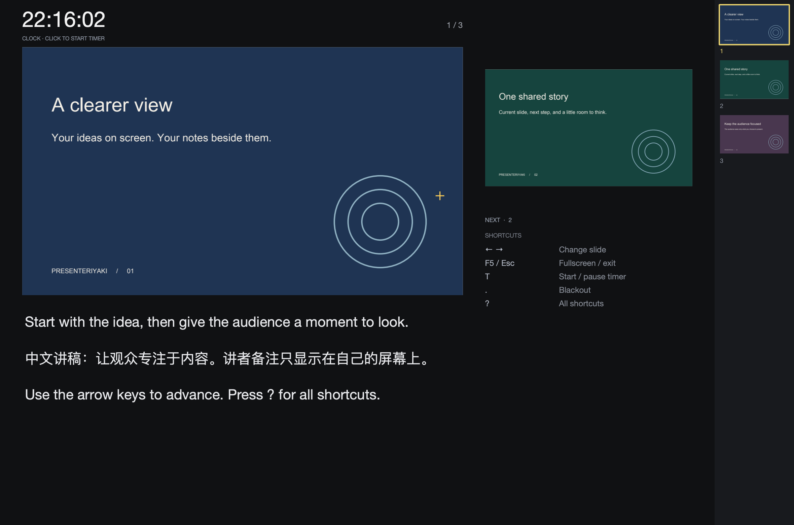

# Presenteriyaki

A minimalist PDF presentation app for macOS and Windows.

Show slides on one screen while keeping speaker notes, the next slide and a
timer on the other. Use a single screen to rehearse.

## Features

- Presenter and audience windows with fullscreen and display switching
- Speaker notes, slide thumbnails and a presentation timer
- Drawing, whiteboard, laser pointer and spotlight
- Video, audio and LaTeX animations
- Optional camera overlay and web content

## Install

Presenteriyaki runs as a standalone app; Python is included.

- **macOS:** open the `.dmg` and drag Presenteriyaki to Applications.
- **Windows:** run `Presenteriyaki-…-setup.exe`, then open it from Start.

Public downloads are not available yet. Developers can
[build the app and installers](CONTRIBUTING.md#build-the-app).

## Getting started

Open Presenteriyaki and drop in a PDF, or choose **File → Open PDF**. Use the arrow
keys to change slides, **F5** for fullscreen and **?** for keyboard help.

See the [user guide](docs/USER_GUIDE.md) for notes, drawing and media controls.

## Development

Built with Python and Qt/PySide. See [CONTRIBUTING.md](CONTRIBUTING.md) for setup,
testing and packaging.

## License

[MIT](LICENSE). Bundled dependencies retain their own licenses; see the
[distribution notes](docs/DISTRIBUTION.md).
